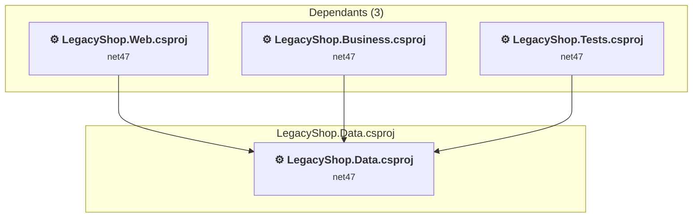

# LegacyShop.Data\LegacyShop.Data.csproj

[← Back to the assessment index](../../assessment.md)

## Project Info

- **Current Target Framework:** net47
- **Proposed Target Framework:** net10.0
- **SDK-style**: False
- **Project Kind:** ClassicClassLibrary
- **Dependencies**: 0
- **Dependants**: 3
- **Number of Files**: 22
- **Number of Files with Incidents**: 2
- **Lines of Code**: 699
- **Estimated LOC to modify**: 6+ (at least 0.9% of the project)

## Related Projects

**Depended on by (3)** — projects that reference this one:

- [C:\Users\ruchowdhury\OneDrive - Microsoft\Desktop\GHCP Demo\GHCP-Modernization\LegacyShop.Business\LegacyShop.Business.csproj](../projects/LegacyShop.Business.md)
- [C:\Users\ruchowdhury\OneDrive - Microsoft\Desktop\GHCP Demo\GHCP-Modernization\LegacyShop.Tests\LegacyShop.Tests.csproj](../projects/LegacyShop.Tests.md)
- [C:\Users\ruchowdhury\OneDrive - Microsoft\Desktop\GHCP Demo\GHCP-Modernization\LegacyShop.Web\LegacyShop.Web.csproj](../projects/LegacyShop.Web.md)

## Dependency Graph

Legend:
📦 SDK-style project
⚙️ Classic project

## API Compatibility

| Category | Count | Impact |
| :--- | :---: | :--- |
| 🔴 Binary Incompatible | 0 | High - Require code changes |
| 🟡 Source Incompatible | 6 | Medium - Needs re-compilation and potential conflicting API error fixing |
| 🔵 Behavioral change | 0 | Low - Behavioral changes that may require testing at runtime |
| ✅ Compatible | 773 |  |
| ***Total APIs Analyzed*** | ***779*** |  |

## NuGet Package Issues

| Package | Current Version | Suggested Version | Severity | Issue |
| :--- | :---: | :---: | :---: | :--- |
| EntityFramework | 6.4.4 | 6.5.2 | 🟡 Potential | NuGet package upgrade is recommended |

Every project affected by these packages, and the versions the repository settles on: [aggregate NuGet packages](../nuget/aggregate-packages.md).

## Binding Redirect Configuration

| Rule | Severity | Details | Recommendation |
| :--- | :---: | :--- | :--- |
| AutoGenerateBindingRedirects not set and no manual redirects | 🟡 Potential | AutoGenerateBindingRedirects is not set in LegacyShop.Data.csproj, no manual redirects found | Explicitly enable <AutoGenerateBindingRedirects>true</AutoGenerateBindingRedirects> or add manual binding redirects. |

## Project Technologies and Features

| Technology | Issues | Percentage | Migration Path |
| :--- | :---: | :---: | :--- |
| Legacy Configuration System | 6 | 100.0% | Legacy XML-based configuration system (app.config/web.config) that has been replaced by a more flexible configuration model in .NET Core. The old system was rigid and XML-based. Migrate to Microsoft.Extensions.Configuration with JSON/environment variables; use System.Configuration.ConfigurationManager NuGet package as interim bridge if needed. |

