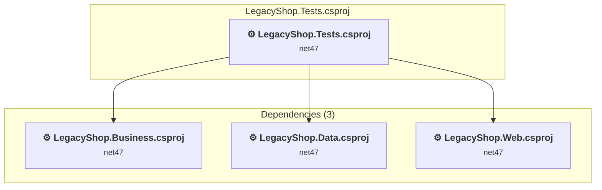

# LegacyShop.Tests\LegacyShop.Tests.csproj

[← Back to the assessment index](../../assessment.md)

## Project Info

- **Current Target Framework:** net47
- **Proposed Target Framework:** net10.0
- **SDK-style**: False
- **Project Kind:** ClassicClassLibrary
- **Dependencies**: 3
- **Dependants**: 0
- **Number of Files**: 4
- **Number of Files with Incidents**: 3
- **Lines of Code**: 181
- **Estimated LOC to modify**: 1+ (at least 0.6% of the project)

## Related Projects

**Depends on (3)** — projects this one references:

- [C:\Users\ruchowdhury\OneDrive - Microsoft\Desktop\GHCP Demo\GHCP-Modernization\LegacyShop.Business\LegacyShop.Business.csproj](../projects/LegacyShop.Business.md)
- [C:\Users\ruchowdhury\OneDrive - Microsoft\Desktop\GHCP Demo\GHCP-Modernization\LegacyShop.Data\LegacyShop.Data.csproj](../projects/LegacyShop.Data.md)
- [C:\Users\ruchowdhury\OneDrive - Microsoft\Desktop\GHCP Demo\GHCP-Modernization\LegacyShop.Web\LegacyShop.Web.csproj](../projects/LegacyShop.Web.md)

## Dependency Graph

Legend:
📦 SDK-style project
⚙️ Classic project

## API Compatibility

| Category | Count | Impact |
| :--- | :---: | :--- |
| 🔴 Binary Incompatible | 1 | High - Require code changes |
| 🟡 Source Incompatible | 0 | Medium - Needs re-compilation and potential conflicting API error fixing |
| 🔵 Behavioral change | 0 | Low - Behavioral changes that may require testing at runtime |
| ✅ Compatible | 249 |  |
| ***Total APIs Analyzed*** | ***250*** |  |

## NuGet Package Issues

| Package | Current Version | Suggested Version | Severity | Issue |
| :--- | :---: | :---: | :---: | :--- |
| Microsoft.AspNet.Mvc | 5.2.9 | — | 🔴 Mandatory | NuGet package functionality is included with framework reference |
| Microsoft.AspNet.Razor | 3.2.9 | — | 🔴 Mandatory | NuGet package functionality is included with framework reference |
| Microsoft.AspNet.WebPages | 3.2.9 | — | 🔴 Mandatory | NuGet package functionality is included with framework reference |
| System.Runtime.CompilerServices.Unsafe | 4.5.3 | 6.1.2 | 🟡 Potential | NuGet package upgrade is recommended |
| System.Threading.Tasks.Extensions | 4.5.4 | — | 🔴 Mandatory | NuGet package functionality is included with framework reference |

Every project affected by these packages, and the versions the repository settles on: [aggregate NuGet packages](../nuget/aggregate-packages.md).

## Binding Redirect Configuration

| Rule | Severity | Details | Recommendation |
| :--- | :---: | :--- | :--- |
| Library-hosted entry point missing GenerateBindingRedirectsOutputType | 🟡 Potential | OutputType=Library with test framework references, GenerateBindingRedirectsOutputType not set | Add <GenerateBindingRedirectsOutputType>true</GenerateBindingRedirectsOutputType> so MSBuild generates redirects for library-hosted entry points. |
| Binding redirect forces version downgrade | 🟡 Potential | Binding redirect for System.Runtime.CompilerServices.Unsafe targets 4.0.6.0 but package provides 4.5.3 | Update the binding redirect newVersion to match the version provided by the NuGet package. |
| Binding redirect forces version downgrade | 🟡 Potential | Binding redirect for System.Threading.Tasks.Extensions targets 4.2.0.1 but package provides 4.5.4 | Update the binding redirect newVersion to match the version provided by the NuGet package. |

## Project Technologies and Features

| Technology | Issues | Percentage | Migration Path |
| :--- | :---: | :---: | :--- |
| ASP.NET Framework (System.Web) | 1 | 100.0% | Legacy ASP.NET Framework APIs for web applications (System.Web.*) that don't exist in ASP.NET Core due to architectural differences. ASP.NET Core represents a complete redesign of the web framework. Migrate to ASP.NET Core equivalents or consider System.Web.Adapters package for compatibility. |

