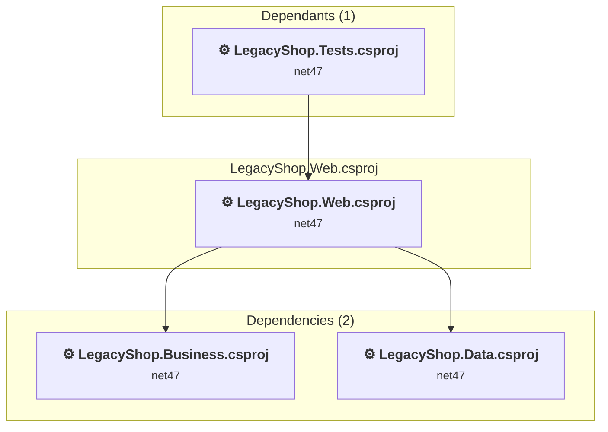

# LegacyShop.Web\LegacyShop.Web.csproj

[← Back to the assessment index](../../assessment.md)

## Project Info

- **Current Target Framework:** net47
- **Proposed Target Framework:** net10.0
- **SDK-style**: False
- **Project Kind:** Wap
- **Dependencies**: 2
- **Dependants**: 1
- **Number of Files**: 49
- **Number of Files with Incidents**: 16
- **Lines of Code**: 1422
- **Estimated LOC to modify**: 367+ (at least 25.8% of the project)

## Related Projects

**Depends on (2)** — projects this one references:

- [C:\Users\ruchowdhury\OneDrive - Microsoft\Desktop\GHCP Demo\GHCP-Modernization\LegacyShop.Business\LegacyShop.Business.csproj](../projects/LegacyShop.Business.md)
- [C:\Users\ruchowdhury\OneDrive - Microsoft\Desktop\GHCP Demo\GHCP-Modernization\LegacyShop.Data\LegacyShop.Data.csproj](../projects/LegacyShop.Data.md)

**Depended on by (1)** — projects that reference this one:

- [C:\Users\ruchowdhury\OneDrive - Microsoft\Desktop\GHCP Demo\GHCP-Modernization\LegacyShop.Tests\LegacyShop.Tests.csproj](../projects/LegacyShop.Tests.md)

## Dependency Graph

Legend:
📦 SDK-style project
⚙️ Classic project

## API Compatibility

| Category | Count | Impact |
| :--- | :---: | :--- |
| 🔴 Binary Incompatible | 365 | High - Require code changes |
| 🟡 Source Incompatible | 2 | Medium - Needs re-compilation and potential conflicting API error fixing |
| 🔵 Behavioral change | 0 | Low - Behavioral changes that may require testing at runtime |
| ✅ Compatible | 542 |  |
| ***Total APIs Analyzed*** | ***909*** |  |

## NuGet Package Issues

| Package | Current Version | Suggested Version | Severity | Issue |
| :--- | :---: | :---: | :---: | :--- |
| Antlr | 3.5.0.2 | Replace with new package Antlr4=4.6.6 | 🟡 Potential | NuGet package upgrade is recommended |
| EntityFramework | 6.4.4 | 6.5.2 | 🟡 Potential | NuGet package upgrade is recommended |
| Microsoft.AspNet.Mvc | 5.2.9 | — | 🔴 Mandatory | NuGet package functionality is included with framework reference |
| Microsoft.AspNet.Razor | 3.2.9 | — | 🔴 Mandatory | NuGet package functionality is included with framework reference |
| Microsoft.AspNet.Web.Optimization | 1.1.3 | — | 🔴 Mandatory | NuGet package is incompatible |
| Microsoft.AspNet.WebPages | 3.2.9 | — | 🔴 Mandatory | NuGet package functionality is included with framework reference |
| Microsoft.Web.Infrastructure | 2.0.1 | — | 🔴 Mandatory | NuGet package functionality is included with framework reference |
| Newtonsoft.Json | 13.0.3 | 13.0.4 | 🟡 Potential | NuGet package upgrade is recommended |

Every project affected by these packages, and the versions the repository settles on: [aggregate NuGet packages](../nuget/aggregate-packages.md).

## Binding Redirect Configuration

| Rule | Severity | Details | Recommendation |
| :--- | :---: | :--- | :--- |
| Binding redirect forces version downgrade | 🟡 Potential | Binding redirect for Newtonsoft.Json targets 13.0.0.0 but package provides 13.0.3 | Update the binding redirect newVersion to match the version provided by the NuGet package. |

## Project Technologies and Features

| Technology | Issues | Percentage | Migration Path |
| :--- | :---: | :---: | :--- |
| ASP.NET Framework (System.Web) | 367 | 100.0% | Legacy ASP.NET Framework APIs for web applications (System.Web.*) that don't exist in ASP.NET Core due to architectural differences. ASP.NET Core represents a complete redesign of the web framework. Migrate to ASP.NET Core equivalents or consider System.Web.Adapters package for compatibility. |

